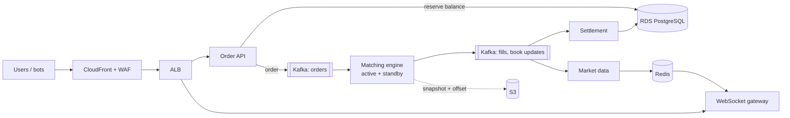
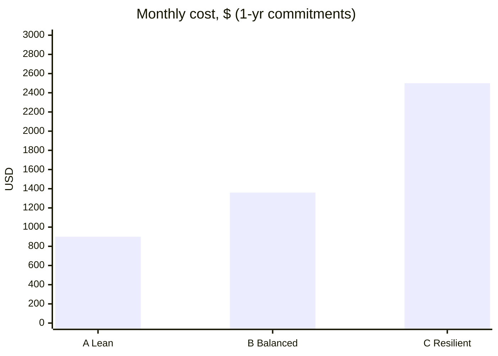

# Problem 1: Highly available trading system on AWS

A Binance-style spot exchange. 500 req/s is small, so the design spends money on correctness (no lost orders, no double-spent balances) and availability, not raw scale.

| | |
|---|---|
| Scope | Spot trading: place/cancel orders, matching, live order book + trades (WebSocket), balances |
| Out of scope | Futures, margin, KYC, fiat, on-chain deposits |
| Traffic | 500 req/s peak, ~150 average, ~10k WebSocket clients |
| Targets | p99 < 100 ms to accept an order · no lost or duplicate orders · survive losing an AZ |
| Region | `ap-southeast-1`, 3 AZs |

## Contents

- [Architecture (Option B)](#architecture-option-b)
- [Option A: Lean (launch)](#option-a-lean-launch)
- [Option B: Balanced (target)](#option-b-balanced-target)
- [Option C: Resilient (regulated / high stakes)](#option-c-resilient-regulated--high-stakes)
- [Comparison](#comparison)
- [Shared cost: data out](#shared-cost-data-out)
- [Cost levers](#cost-levers)
- [How it stays up](#how-it-stays-up)
- [Latency budget (p99, order accepted)](#latency-budget-p99-order-accepted)
- [Services and alternatives](#services-and-alternatives)
- [Scaling plan](#scaling-plan)

## Architecture (Option B)

Orders go through a durable log. The API reserves the balance and writes the order to Kafka; one matching engine per symbol reads it, and settlement and market data run off the engine's output.

All services run on ECS Fargate, 3 tasks across 3 AZs.

## Option A: Lean (launch)

Same services, but the order log is an ordered Postgres table instead of Kafka. Cheapest way to launch.

| Component | Choice | ~$/mo |
|---|---|---|
| Compute | Fargate, 13 small tasks | 315 |
| Order log | Ordered Postgres table (no Kafka) | 0 |
| Database | RDS PostgreSQL Multi-AZ, m7g.large | 275 |
| Cache | Redis t4g.medium ×2 | 95 |
| Edge | WAF + ALB | 280 |
| Network / logs | 1 NAT, CloudWatch | 125 |
| **Total** | on-demand / 1-yr commitments | **1,090 / 900** |

| Pros | Cons |
|---|---|
| Cheapest, fewest moving parts | Every order is a DB write: tops out around 10x traffic |
| Recovery is exact (replay the table) | Engine recovery takes minutes, not seconds |

## Option B: Balanced (target)

The diagram above. Kafka (MSK) carries orders and events, so the engine fails over in seconds and the system can grow.

| Component | Choice | ~$/mo |
|---|---|---|
| Compute | Fargate, 13 small tasks | 315 |
| Order log | MSK, 3× m7g.large | 465 |
| Database | RDS PostgreSQL Multi-AZ, m7g.large | 275 |
| Cache | Redis t4g.medium ×2 | 95 |
| Edge | WAF + ALB | 280 |
| Network / logs | 1 NAT, CloudWatch | 125 |
| **Total** | on-demand / 1-yr commitments | **1,550 / 1,360** |

| Pros | Cons |
|---|---|
| Kafka adds ~5 ms; engine fails over in seconds | MSK is the biggest line and has no reserved pricing |
| Grows to ~100x by adding partitions | More to operate than A |

## Option C: Resilient (regulated / high stakes)

Option B plus faster database failover (Aurora) and a standby copy in a second region.

| Component | Choice | ~$/mo |
|---|---|---|
| Compute | Fargate, 13 small tasks | 315 |
| Order log | MSK + cross-region replication | 650 |
| Database | Aurora writer + reader, Global Database | 760 |
| Cache | Redis Multi-AZ | 235 |
| Edge | WAF + ALB | 280 |
| Network / logs | 3 NAT, CloudWatch | 255 |
| Second region | Pilot light (replicas only, no compute) | 455 |
| **Total** | on-demand / 1-yr commitments | **2,950 / 2,500** |

| Pros | Cons |
|---|---|
| AZ failover < 30 s, region failover ~15 min | ~2x the cost of B |
| < 1 min of data lost if a region goes down | Global DB and replication add operational work |

## Comparison

What each option costs, and what it buys you when things fail.

| | A | B | C |
|---|---|---|---|
| Lose 1 AZ | 1-2 min cancel-only | 1-2 min cancel-only | < 30 s |
| Lose the region | hours | hours | ~15 min |
| Data lost (region) | minutes | minutes | < 1 min |
| Engine failover | minutes | seconds | seconds |
| Grows to | ~10x | ~100x | ~100x |

**Recommendation:** launch on A → move to B before ~10x traffic → C only when a region outage costs more than ~$1.5k/mo. A→B is small: the engine reads Kafka instead of a table.

## Shared cost: data out

Same for every option, and bigger than all of them.

| Market data per client | 10k clients, data/mo | ~$/mo |
|---|---|---|
| 2 KB/s, full book updates | 50 TB | 5,000 |
| Deltas + compressed frames (~70% smaller) | 15 TB | 1,500 |

## Cost levers

Ways to cut the bill in any option, and what each one costs you.

| Lever | Saves | Catch |
|---|---|---|
| 1-yr Savings Plan + RDS/Redis reservations | ~12-17% | 1-year commitment (MSK has no reserved pricing) |
| 1 NAT instead of 3 | ~$90/mo | Outbound internet lost if that AZ fails; trading unaffected |
| S3 gateway endpoint | NAT data charges | None, it's free |
| Auto-scaling | Little now | Min 3 tasks for HA already covers peak; matters at growth |
| Fargate Spot | ~70% on batch work | Interruptible: never API or engine |
| Non-prod off at night | ~60-70% of non-prod | None |

## How it stays up

The failures that matter for an exchange, and how the design handles each.

| Risk | Handling |
|---|---|
| Task / AZ failure | 3 tasks across 3 AZs; 2 can carry peak |
| Engine crash | Standby replays the same log; snapshot + offset = exact recovery |
| Two engines active | Lease picks the active one; Kafka fencing rejects writes from a stale one |
| Bad order message | Engine emits `rejected`, never crashes; unprocessable → dead-letter topic + alert |
| Retries / duplicates | Client order ID; settlement keyed on trade ID |
| DB failover | API switches to cancel-only for 1-2 min |
| Traffic spike | Kafka buffers; scale on consumer lag, not CPU |

## Latency budget (p99, order accepted)

Time for an order to be accepted (`202`), step by step.

| Step | ms |
|---|---|
| ALB | 2 |
| API logic | 3 |
| Balance reserve (Postgres) | 5-10 |
| Kafka write, 3 AZs | 5-15 |
| **Total** | **~30** (target 100) |

## Services and alternatives

Each main choice and what it beat.

| Choice | Instead of | Why |
|---|---|---|
| ECS Fargate | EKS | No node patching; EKS adds $73/mo + upgrades we don't need yet |
| MSK | Kinesis / SQS | Kinesis adds 70-200 ms per hop; SQS deletes messages, so no replay |
| RDS PostgreSQL | DynamoDB / Aurora | Ledger needs ACID; Aurora's faster failover costs ~30% more (Option C) |
| ALB WebSocket | API Gateway WebSocket | API Gateway bills per message; market data is thousands/s |
| WAF per API key | Per IP only | Abuse is one bot with valid keys spamming orders |

## Scaling plan

What changes as traffic grows past today's setup.

| Traffic | Change |
|---|---|
| ~5k req/s | Move to B; read replicas for history; WebSocket on its own ALB |
| ~50k req/s | Shard engines by symbol; in-memory risk check instead of DB write; Aurora; consider EKS |
| Always | One writer per symbol; multi-region active-active for reads only |

Prices are approximate `ap-southeast-1` list prices, and the traffic numbers are estimates. With real volumes I'd redo the cost tables first. Security is in Problem 5.
