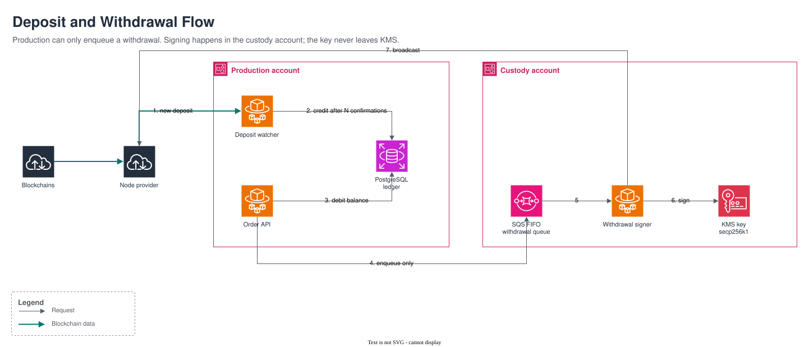
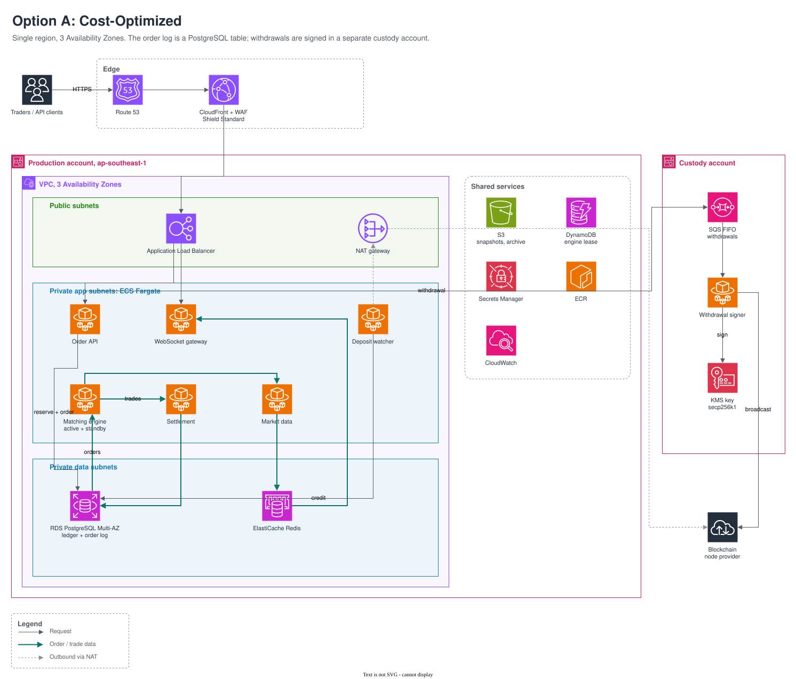
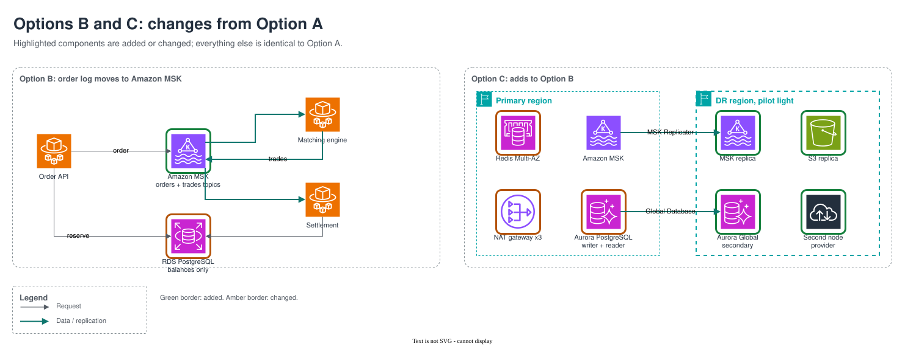
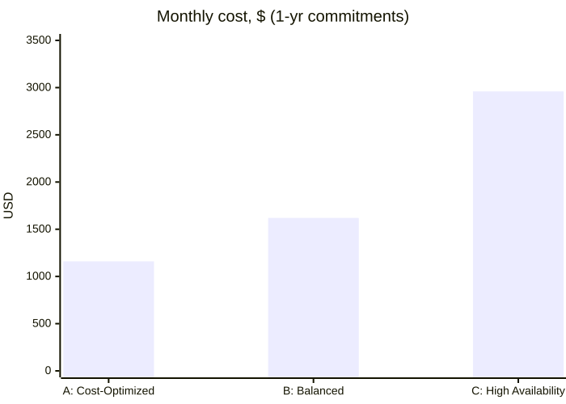

# Problem 1: Highly Available Trading System on AWS

A Binance-style spot exchange. At 500 req/s the main challenges are correctness (no lost orders, no double-spent balances) and availability rather than throughput, so the budget prioritizes those.

| | |
|---|---|
| Scope | Spot trading: place/cancel orders, matching, live order book + trades (WebSocket), balances, on-chain deposits and withdrawals |
| Out of scope | Futures, margin, KYC, fiat |
| Traffic | 500 req/s peak, ~150 average, ~10k WebSocket clients |
| Targets | p99 < 100 ms to accept an order · no lost or duplicate orders · survive losing an AZ |
| Region | `ap-southeast-1`, 3 AZs |

## Contents

- [Architecture Overview](#architecture-overview)
- [Deposit and Withdrawal Flow](#deposit-and-withdrawal-flow)
- [Deployment Options](#deployment-options)
- [Options Comparison](#options-comparison)
- [Data Transfer Cost](#data-transfer-cost)
- [Cost Optimization](#cost-optimization)
- [High Availability and Fault Tolerance](#high-availability-and-fault-tolerance)
- [Latency Budget](#latency-budget)
- [Technology Choices](#technology-choices)
- [Scaling Plan](#scaling-plan)

## Architecture Overview

The Order API reserves the user's balance in PostgreSQL, then appends the order to a durable, ordered **order log**. The matching engine consumes the log, matches orders, and publishes executed trades to a trades log. Settlement applies those trades to account balances, and the market data service streams the order book to clients over WebSocket.

All services run on ECS Fargate with three tasks across three Availability Zones. Each trading pair has a single active matching engine and a warm standby that consumes the same log for failover.

## Deposit and Withdrawal Flow

On-chain funds movement is isolated from the trading path. It is not latency-sensitive, but it carries the highest financial risk, so signing runs in a separate AWS account. Security controls are detailed in Problem 5.

| Part | What it does | Why this way |
|---|---|---|
| Node provider | Reads and sends blockchain transactions | Running our own nodes is ~$300/mo per chain plus ops; a provider is cheaper at this size |
| Deposit watcher | Credits a deposit after N confirmations | Keyed on transaction hash, so a deposit can never be credited twice |
| Withdrawal queue | Holds approved withdrawals until signed | Durable: a signer outage delays withdrawals, never loses them |
| Withdrawal signer | Signs and broadcasts in a separate AWS account | Production can only add to the queue, never sign |
| KMS secp256k1 key | Signing key for the hot wallet | Key stays in AWS's FIPS 140-2 L3 hardware; ~$20/mo vs ~$2,100/mo for 2 CloudHSM units |
| Hot / cold split | Only a small share of funds is online | A full compromise can only reach the hot wallet |

## Deployment Options

All options share the architecture above. They differ in the order log implementation, database failover time, and disaster recovery scope, which trades cost against resilience.

AWS services per option:

| AWS service | Used for | A | B | C |
|---|---|---|---|---|
| Route 53, ACM | DNS, TLS certificates | Yes | Yes | Yes |
| CloudFront, AWS WAF, Shield Standard | Edge TLS, rate limiting, DDoS protection | Yes | Yes | Yes |
| Application Load Balancer | HTTP and WebSocket routing | Yes | Yes | Yes |
| ECS Fargate | All application services | Yes | Yes | Yes |
| RDS PostgreSQL Multi-AZ | Balances, orders, trades | Yes, also the order log | Yes | No |
| Amazon MSK | Order and trade logs | No | Yes | Yes, replicated cross-region |
| Aurora PostgreSQL + Global Database | Replaces RDS | No | No | Yes |
| ElastiCache Redis | Order book snapshots for clients | Primary + replica | Primary + replica | Multi-AZ |
| DynamoDB | Matching engine leader lease | Yes | Yes | Yes |
| S3 | Engine snapshots, archive, backups | Yes | Yes | Yes, cross-region replicated |
| SQS FIFO, KMS (custody account) | Withdrawal queue, signing key | Yes | Yes | Yes |
| Secrets Manager, ECR, CloudWatch | Credentials, images, observability | Yes | Yes | Yes |
| NAT gateway | Outbound access | 1 | 1 | 3 |
| Second region | Disaster recovery | Snapshot copies | Snapshot copies | Pilot light |

### Option A: Cost-Optimized

The order log is implemented as an append-only PostgreSQL table, avoiding a separate streaming platform. Suitable for launch.

Editable source: [`option-a-aws.drawio`](images/option-a-aws.drawio) (open at app.diagrams.net).

| Component | Choice | ~$/mo |
|---|---|---|
| Compute | Fargate, 13 small tasks | 315 |
| Order log | Ordered Postgres table (no Kafka) | 0 |
| Database | RDS PostgreSQL Multi-AZ, m7g.large | 275 |
| Cache | Redis t4g.medium ×2 | 95 |
| Edge | WAF + ALB | 280 |
| Network / logs | 1 NAT, CloudWatch | 125 |
| Wallet | Deposit + withdrawal services, node provider, KMS | 260 |
| **Total** | on-demand / 1-yr commitments | **1,350 / 1,160** |

Option A is the baseline. Options B and C are compared against it.

### Option B: Balanced

Option A with the order log moved from PostgreSQL to Amazon MSK (Kafka). Engine failover drops to seconds and throughput scales by adding partitions.

Changes from Option A for both Options B and C (green border: added, amber border: changed):

| Component | Choice | ~$/mo |
|---|---|---|
| Compute | Fargate, 13 small tasks | 315 |
| Order log | MSK, 3× m7g.large | 465 |
| Database | RDS PostgreSQL Multi-AZ, m7g.large | 275 |
| Cache | Redis t4g.medium ×2 | 95 |
| Edge | WAF + ALB | 280 |
| Network / logs | 1 NAT, CloudWatch | 125 |
| Wallet | Deposit + withdrawal services, node provider, KMS | 260 |
| **Total** | on-demand / 1-yr commitments | **1,810 / 1,620** |

**Pros compared with A**

- Matching keeps running during a database failover; in A, matching pauses for 1-2 min.
- Handles about 10x more orders (~50,000/s vs ~5,000/s).
- Faster engine failover (~5-10 s vs ~10-30 s).

**Cons compared with A**

- Costs ~$460/month more; MSK has no reserved pricing.
- Adds ~10 ms to order acceptance (~30 ms vs ~20 ms).
- One more system to operate: the Kafka cluster.

### Option C: High Availability

Option B with Aurora for faster database failover and a pilot-light disaster recovery region. Suitable for regulated operation.

The changes for Option C are shown in the diagram under Option B.

| Component | Choice | ~$/mo |
|---|---|---|
| Compute | Fargate, 13 small tasks | 315 |
| Order log | MSK + cross-region replication | 650 |
| Database | Aurora writer + reader, Global Database | 760 |
| Cache | Redis Multi-AZ | 235 |
| Edge | WAF + ALB | 280 |
| Network / logs | 3 NAT, CloudWatch | 255 |
| Second region | Pilot light (replicas only, no compute) | 455 |
| Wallet | Same as B + a second node provider for failover | 460 |
| **Total** | on-demand / 1-yr commitments | **3,410 / 2,960** |

**Pros compared with A**

- Everything B adds.
- Database failover in under 30 s instead of 1-2 min.
- Survives a full region outage: back in ~15 min with under 1 min of data lost, instead of hours.

**Cons compared with A**

- Costs ~$1,800/month more.
- Adds ~10 ms to order acceptance, as in B.
- Most to operate: Kafka, Aurora Global Database, cross-region replication, and regular DR drills.

## Options Comparison

Monthly cost and recovery characteristics per option.

| | A | B | C |
|---|---|---|---|
| Lose 1 AZ | 1-2 min cancel-only | 1-2 min cancel-only | < 30 s |
| Lose the region | hours | hours | ~15 min |
| Data lost (region) | minutes | minutes | < 1 min |
| Engine failover | ~10-30 s | ~5-10 s | ~5-10 s |
| Grows to | ~10x | ~100x | ~100x |

**Recommendation:** launch on Option A and migrate to Option B before traffic reaches about 10x; the migration only changes the engine's log source. Adopt Option C when the business impact of a regional outage exceeds its additional cost of about $1.5k/month.

## Data Transfer Cost

Data transfer out applies to every option and is the largest cost driver.

| Market data per client | 10k clients, data/mo | ~$/mo |
|---|---|---|
| 2 KB/s, full book updates | 50 TB | 5,000 |
| Deltas + compressed frames (~70% smaller) | 15 TB | 1,500 |

## Cost Optimization

Applicable to all options.

| Lever | Saves | Catch |
|---|---|---|
| 1-yr Savings Plan + RDS/Redis reservations | ~12-17% | 1-year commitment (MSK has no reserved pricing) |
| Single NAT gateway | About $90/mo | Outbound connectivity lost if its AZ fails; trading unaffected |
| S3 gateway endpoint | NAT data processing charges | None (no charge) |
| Auto-scaling | Minimal at current load | The 3-task HA minimum already covers peak; relevant as traffic grows |
| Fargate Spot | About 70% on batch workloads | Interruptible; not for the API or matching engine |
| Scheduled shutdown of non-production | About 60-70% of non-production cost | None |

## High Availability and Fault Tolerance

Failure scenarios and mitigations. Where options differ, each is listed.

| Risk | Handling |
|---|---|
| Task / AZ failure | 3 tasks across 3 AZs; 2 can carry peak |
| Engine crash | Standby replays the log from the last snapshot position. A: from the table (~10-30 s); B, C: from Kafka (~5-10 s) |
| Two engines active | DynamoDB lease selects the active engine. A: writes carry a lease version checked by the database; B, C: Kafka transactional fencing rejects a stale engine |
| Bad order message | Engine emits `rejected` and continues; unprocessable entries go to a dead-letter table (A) or topic (B, C) with an alert |
| Retries / duplicates | Client order ID; settlement keyed on trade ID |
| DB failover | A, B: API switches to cancel-only for 1-2 min; C: Aurora fails over in under 30 s |
| Traffic spike | The order log buffers bursts; services scale on consumer lag, not CPU |
| Node provider outage | Withdrawals wait in the queue; deposits are credited once it's back (C: second provider) |
| Withdrawal retried | Idempotent on withdrawal ID; one nonce per withdrawal, so a retry never pays twice |

## Latency Budget

p99 latency to order acceptance (`202`), target 100 ms.

| Step | A (ms) | B, C (ms) |
|---|---|---|
| ALB | 2 | 2 |
| API logic | 3 | 3 |
| Balance reserve (PostgreSQL) | 5-10 | 5-10 |
| Order log write | same transaction | 5-15 (Kafka, 3 AZs) |
| **Total** | **~20** | **~30** |

## Technology Choices

Selected services and the alternatives considered.

| Choice | Instead of | Why |
|---|---|---|
| ECS Fargate | EKS | No node patching; EKS adds $73/mo + upgrades we don't need yet |
| MSK | Kinesis / SQS | Kinesis adds 70-200 ms per hop; SQS deletes messages, so no replay |
| RDS PostgreSQL | DynamoDB / Aurora | Ledger needs ACID; Aurora's faster failover costs ~30% more (Option C) |
| ALB WebSocket | API Gateway WebSocket | API Gateway bills per message; market data is thousands/s |
| WAF per API key | Per IP only | Abuse is one bot with valid keys spamming orders |
| KMS secp256k1 | CloudHSM / MPC provider | Same hardware-backed keys for ~$20 vs ~$2,100/mo; MPC adds insurance but costs thousands |
| Node provider | Own nodes | ~$200/mo vs ~$300/mo per chain plus syncing and upgrades |

## Scaling Plan

Changes required as traffic grows.

| Traffic | Change |
|---|---|
| ~5k req/s | Move to B; read replicas for history; WebSocket on its own ALB |
| ~50k req/s | Shard engines by symbol; in-memory risk check instead of DB write; Aurora; consider EKS |
| Always | One writer per symbol; multi-region active-active for reads only |

Prices are approximate `ap-southeast-1` on-demand list prices; traffic figures are estimates to be revalidated against real volumes. Security is covered in Problem 5.
