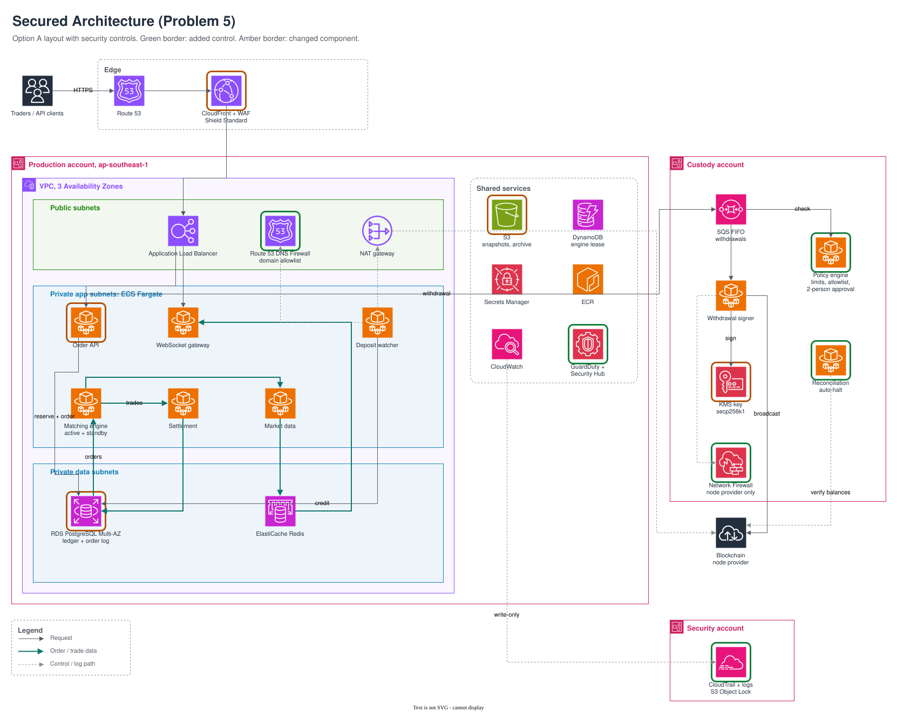

# Problem 5: Securing the Trading Platform

This document secures the Problem 1 design across all three deployment options. The guiding question is: if one component is fully compromised, what still protects customer funds? Controls are prioritized by financial loss, and each one is costed.

## Contents

- [Threat Model](#threat-model)
- [Secured Architecture](#secured-architecture)
- [Security Changes](#security-changes)
- [Security Cost](#security-cost)
- [Priorities](#priorities)
- [Accepted Risks](#accepted-risks)
- [Open Questions](#open-questions)
- [Verification](#verification)

## Threat Model

The assets an attacker would target, ranked by impact.

| Asset | Main threat | Impact |
|---|---|---|
| Hot wallet funds (signing key) | Key misuse or unauthorized withdrawals | Direct, irreversible loss of customer funds |
| Account balances (ledger) | Forged trades or direct balance edits | Funds created from nothing, then withdrawn |
| User accounts and API keys | Credential stuffing, stolen bot keys | Unauthorized trading or withdrawals |
| Order and trade integrity | Tampered log or engine state | Incorrect fills, market manipulation |
| Audit trail | Log deletion after a breach | Breach cannot be investigated or proven |
| Availability | DDoS, abusive clients | Trading halted |

## Secured Architecture

The Option A layout with security changes marked. The same controls apply to Options B and C; differences are noted in the change table.

Editable source: [`secured-architecture.drawio`](images/secured-architecture.drawio).

Legend: green = added, amber = changed.

## Security Changes

Each change, what it protects against, and its monthly cost.

| # | Change | Type | Protects against | ~$/mo |
|---|---|---|---|---|
| 1 | Withdrawal policy engine in the custody account: per-user and platform limits, address allowlist with a 24 h cooling period, 2-person approval above a threshold. Rules stored in custody, not in the production database | Added | A compromised production account draining the hot wallet | 15 |
| 2 | Network Firewall in the custody account; only the node provider is reachable | Added | Key misuse or data exfiltration from custody | 290 |
| 3 | KMS key policy allows `Sign` only from the signer role; no human principal can sign | Changed | Insider or stolen admin credentials signing transactions | 0 |
| 4 | Hourly reconciliation of on-chain balances against the ledger; any mismatch halts withdrawals and pages on-call | Added | Theft that bypasses every other control | 10 |
| 5 | Hot wallet capped at 5% of assets; the rest in offline multisig cold storage | Changed | Caps the maximum possible loss | 0 |
| 6 | Only the matching engine can write trades. A: database grants; B, C: MSK IAM authorization per topic | Changed | Forged trades crediting balances | 0 |
| 7 | Per-service database roles; the API can only call the balance-reserve function, not update balances directly | Changed | A compromised API or SQL injection editing balances | 0 |
| 8 | API keys scoped to read, trade or withdraw; withdraw disabled by default and limited to allowlisted IPs; requests HMAC-signed | Changed | A stolen bot key being used to withdraw | 0 |
| 9 | Route 53 DNS Firewall in production; only approved domains resolve | Added | Malicious dependencies sending data out or receiving commands | 20 |
| 10 | CloudTrail and logs delivered write-only to a separate security account with S3 Object Lock | Added | Attackers deleting evidence | 30 |
| 11 | GuardDuty (including ECS runtime monitoring) and Security Hub | Added | Undetected compromise | 100 |
| 12 | SSO with FIDO2 keys; no IAM users, no SSH; ECS Exec sessions logged | Changed | Credential phishing, the most common first foothold | 0 |
| 13 | CI/CD uses GitHub OIDC with scoped roles, pinned actions and ECR image scanning (see Problem 4) | Added | Supply chain compromise | 0 |
| 14 | Engine snapshots in S3 with Object Lock and a checksum verified on load | Changed | Poisoned state injected during engine recovery | 0 |
| 15 | WAF rate limits per API key and on login; bot control on authentication endpoints | Changed | Credential stuffing, order spam | 15 |
| 16 | KMS customer-managed keys per data domain; TLS for all traffic, including Kafka and Redis | Changed | Data exposure from a single leaked key or network capture | 10 |

## Security Cost

The added controls cost about $490/month, roughly the same for every option. Network Firewall in the custody account is the largest item.

| Option | Base (1-yr commitments) | Security | Total | Increase |
|---|---|---|---|---|
| A: Cost-Optimized | 1,160 | 490 | 1,650 | 42% |
| B: Balanced | 1,620 | 490 | 2,110 | 30% |
| C: High Availability | 2,960 | 490 | 3,450 | 17% |

Alternatives considered and their cost compared with the selected control:

| Selected | Alternative | Alternative cost | Reason for selection |
|---|---|---|---|
| KMS secp256k1 | CloudHSM (2 units) | ~$2,100/mo | KMS keys are also held in FIPS 140-2 Level 3 hardware |
| DNS Firewall (production) | Network Firewall (production) | ~$290/mo more | Domain blocking covers the common attack; strict control is applied where the key is |
| Shield Standard + WAF | Shield Advanced | $3,000/mo | Exceeds the entire Option A bill; deferred until revenue justifies it |

## Priorities

What must exist before launch, what follows, and what is deferred.

| Must have before launch | First 90 days | Deferred |
|---|---|---|
| Custody account, policy engine, signer-only KMS policy (1, 3) | External penetration test | Shield Advanced, triggered by revenue or a major listing |
| Hot wallet cap and cold storage (5) | Incident response tabletop exercise | Service mesh mTLS |
| Reconciliation with auto-halt (4) | AWS Backup Vault Lock with a tested restore | Public bug bounty |
| Custody egress firewall (2) | Container image signing | 24/7 in-house SOC |
| Trade write restriction and database roles (6, 7) | GuardDuty runtime tuning, Security Hub baselines (11) | CloudHSM or MPC custody |
| Scoped API keys, SSO with FIDO2 (8, 12) | | |
| Separate log account with Object Lock (10) | | |
| Encryption, WAF limits, DNS Firewall (9, 15, 16) | | |

Controls that prevent loss are required at launch; controls that detect or provide assurance follow.

## Accepted Risks

Risks accepted at launch, with the reason and the condition for revisiting.

| Risk | Reason accepted | Mitigation | Revisit when |
|---|---|---|---|
| Production egress directly to an IP address | Network Firewall in production adds ~$290/mo | DNS Firewall, security groups, GuardDuty alerts | A security incident or compliance requirement |
| No Shield Advanced | $3,000/mo exceeds the infrastructure cost | Shield Standard, WAF rate limits, CloudFront absorption | Revenue supports it, or before a major listing |
| No mTLS between services | Few services; mesh adds complexity | Security group rules, per-service IAM and database roles | More than ~25 services |
| No 24/7 SOC | Small team cannot staff it | Automated halts (4), paging, a managed detection retainer | Security hire or larger team |
| KMS instead of dedicated HSM | Dedicated HSM costs ~$2,100/mo | Signer-only key policy, CloudTrail on every `Sign` call | Insurer or regulator requires a dedicated HSM |
| Single region (Options A and B) | Second region doubles cost | Cross-region snapshot copies | Move to Option C |

## Open Questions

Facts not available at design time, how to obtain them, and the assumption used meanwhile.

| Question | Why it matters | How to obtain | Assumed |
|---|---|---|---|
| Licensing jurisdiction | Data residency, retention, breach notification | Legal counsel | Singapore (MAS), `ap-southeast-1` |
| Self-custody or MPC provider | Determines whether the custody account is built or replaced by an integration | Vendor and insurance evaluation | Self-custody with KMS |
| Assets under management and withdrawal volume | Sizes the hot wallet and withdrawal limits | Business projections | Hot wallet at 5% of assets |
| Insurance requirements | Insurers often dictate key storage and hot/cold ratios | Insurance broker, early | Standard crime policy |
| Team size and on-call capacity | SOC vs managed detection, approval workflow load | Hiring plan | Small team, no dedicated security engineer |
| Supported blockchains | Node providers, signing curves, confirmation counts | Product roadmap | BTC and EVM chains (secp256k1) |

## Verification

The controls are tested, not assumed.

| Test | Expected result |
|---|---|
| Purple-team exercise with the goal "move funds" | Blocked by the policy engine or limited to the hot wallet cap |
| Insert a mismatch between ledger and on-chain balance in staging | Withdrawals halt and on-call is paged |
| Connect from a custody task to an unlisted domain or IP | Blocked by Network Firewall and alerted |
| Delete a CloudTrail log from a production admin role | Denied by Object Lock |
| Write a trade as the API role | Denied by database grants or MSK authorization |
| Withdraw with a trade-only API key | Rejected |
